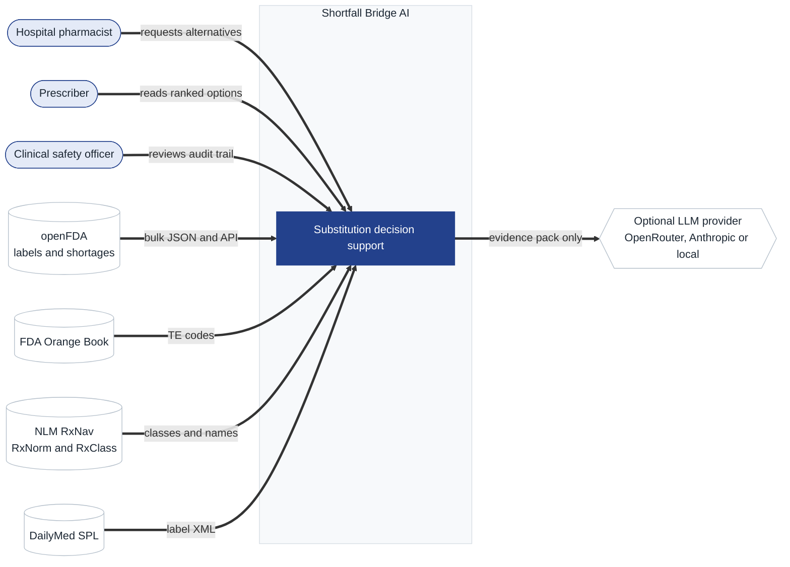
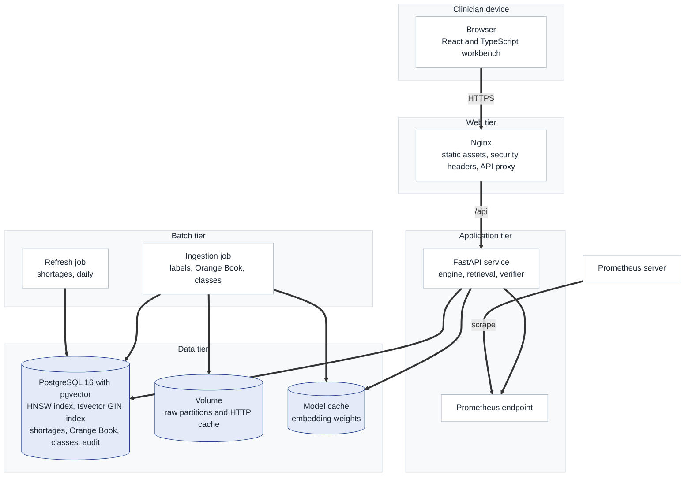
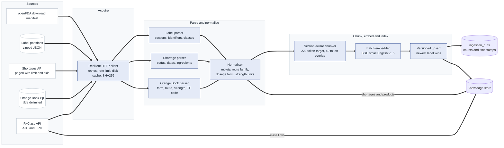
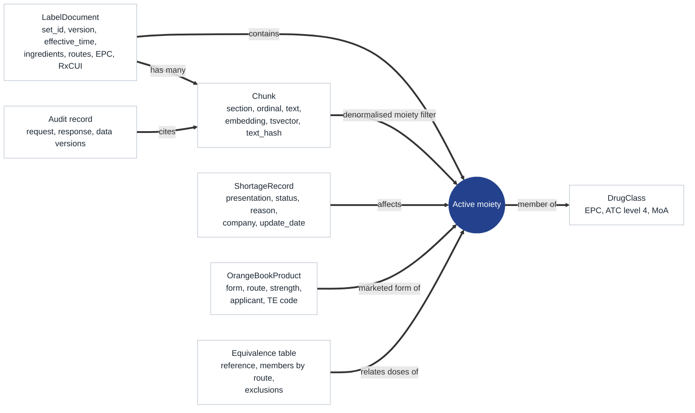
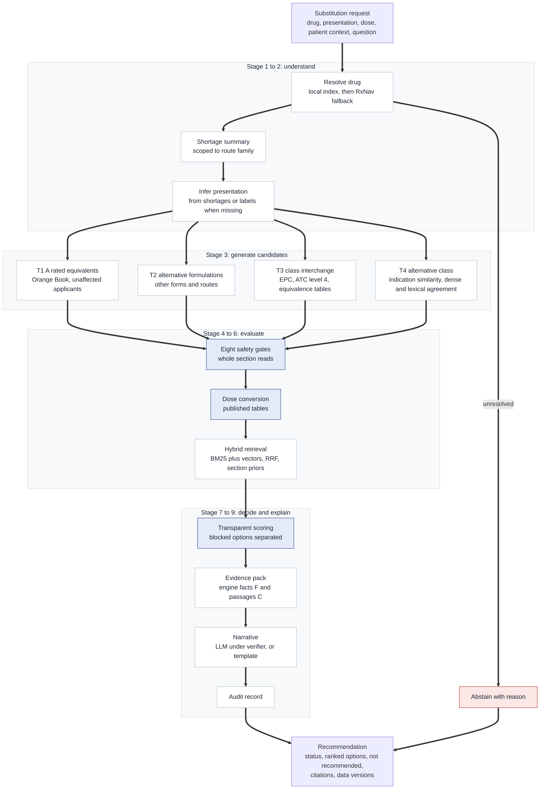
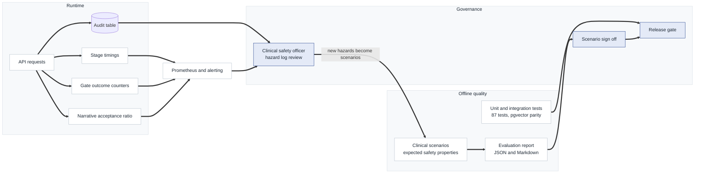

# Shortfall Bridge AI

### Drug Shortage Therapeutic Substitution Intelligence via Label Grounded Retrieval and Deterministic Clinical Safety Gates

Shortfall Bridge AI helps a pharmacist or prescriber answer one urgent question safely: **this medicine is unavailable, what can this patient have instead, at what dose, and how do I know it is safe?** It reads the entire United States drug labelling corpus, the FDA Drug Shortages database, the Orange Book of therapeutic equivalence and the NLM drug class hierarchy. It proposes ranked alternatives across four substitution tiers and screens every option through eight patient specific safety gates. Every finding comes with the official label sentence that justifies it.

<p align="center">
  
</p>

## 1. Project brief

Drug shortages are no longer an occasional supply hiccup. In the United States, active shortages reached a record high in 2024, and the list routinely includes products that hospitals cannot work without: injectable diuretics, corticosteroids, opioid analgesics, antibiotics, chemotherapy agents, local anaesthetics and intravenous fluids. The United Kingdom faces the same pattern through Serious Shortage Protocols and the Department of Health and Social Care supply alerts. Each shortage forces thousands of individual substitution decisions, made under time pressure, usually by a pharmacist working from memory, a printed conversion chart and whatever label text can be found quickly.

Those decisions are where harm enters. A substitution is never just a different product. It can change dose because potency differs, change route because only an oral form is available, change renal handling, introduce an interaction with a medicine the patient already takes, cross a patient's allergy through a related class, or carry a boxed warning the original drug did not have. Published investigations of shortage related medication errors repeatedly describe the same failure modes: wrong dose after an unfamiliar conversion, a contraindication missed in a rushed review, and an alternative that is itself about to run out. The knowledge needed to avoid every one of these errors already exists in public, authoritative sources. It is simply scattered across a hundred thousand labels and several government databases that do not talk to each other.

Generic chat assistants are the wrong tool for this job. A language model asked "what can I use instead of IV furosemide" will produce fluent text, but it cannot prove where a dose came from, it can silently invent a threshold, and it has no reliable knowledge of which products are short this week. Shortfall Bridge AI is designed around the opposite principle. **A deterministic engine makes every clinical decision from structured data and published references. Retrieval supplies the exact label text that justifies each decision. A language model, when enabled, only narrates what the engine already decided, and a verifier rejects any sentence whose numbers, drug names or citations it cannot trace.** When the evidence is insufficient the system abstains and says why. The result is a tool a clinical safety officer can reason about, a pharmacist can audit line by line, and an engineer can test exhaustively.

Version 2 makes the system 

**Deployable in minutes instead of hours**
**demonstrable from a static Netlify site with the real engine on live FDA data**, **plugged into prescribing workflows** through FHIR and CDS Hooks, and **clinically safer**: it fixes ranking defects, estimates renal function from creatinine, checks label dose ceilings and duplicate therapy, and makes the audit trail
tamper evident. Everything is covered by tests: **233 backend tests (87 in v1), with all PostgreSQL
tests actually executed**, plus a **21 check browser end to end test** of the hosted demo.


<a id="capabilities"></a>
## 2. What the system does

<table>
<tr><th align="left">Capability</th><th align="left">How it works</th></tr>
<tr><td>Shortage awareness</td><td>Matches the requested drug and presentation to current FDA shortage entries, reporting affected presentations, reasons and last update date.</td></tr>
<tr><td>Four tier substitution</td><td>T1 A rated therapeutic equivalents from unaffected manufacturers, T2 same ingredient by another form or route, T3 same class interchange, T4 different class with overlapping indications (always flagged for specialist review).</td></tr>
<tr><td>Eight safety gates</td><td>Supply, allergy and cross sensitivity, renal function, hepatic impairment, pregnancy and lactation, drug interactions, boxed warnings, and age. Each returns Clear, Caution, Blocked or Needs data with label citations.</td></tr>
<tr><td>Dose conversion</td><td>Six published equivalence references (opioid MME, systemic corticosteroids, loop diuretics, proton pump inhibitors, statin intensity bands, benzodiazepines). Route aware, unit checked, refuses high risk conversions.</td></tr>
<tr><td>Hybrid retrieval</td><td>BM25 and dense vector search fused by reciprocal rank fusion, filtered to the candidate ingredient, boosted by label section priors inferred from the clinical question and patient context.</td></tr>
<tr><td>Grounded narrative</td><td>Optional LLM summary constrained to engine facts and label passages, checked sentence by sentence for citation validity, numeric grounding and drug grounding, with deterministic template fallback.</td></tr>
<tr><td>Audit trail</td><td>Every request and response stored with data source versions and stage timings, retrievable by reference number.</td></tr>
<tr><td>Clinical workbench</td><td>Accessible React interface with blister strip safety display, evidence drawer in label typography, shortage monitor and an acknowledgement step before notes are copied.</td></tr>
</table>


| Area | v1 | v2 |
|---|---|---|
| Time to first recommendation | multi hour bulk ingestion, about 20 GB | **seconds**: `make live`, or the Netlify demo with no server at all |
| Hosted demo | none | **static Netlify site running the real Python engine in the browser** on live openFDA data |
| Supply gate | penalised oral options when only the injection was short, and said so falsely | scoped to each option's own route and manufacturers |
| Route handling | an oral only drug could outrank an IV option for an IV patient | route availability recorded, mismatch penalised, conversion targets the real route |
| Renal checks | Needs data unless CrCl was typed in | **Cockcroft-Gault, CKD-EPI 2021 and bedside Schwartz** from creatinine, with dialysis handling |
| Dose safety | conversion only | **daily total and labelled maximum daily dose ceiling** with citation |
| Interactions | same ingredient duplicates only | **same class duplicate therapy**; the drug being replaced no longer flags itself |
| Allergy | "sulfamethoxazole" was rewritten into a nonsense term; plural label wording missed | class terms mapped correctly; plural aware; **warnings section cross sensitivity** scanned |
| Ranking transparency | the docs promised visible score terms; only a total was returned | **every additive term returned** and shown as "Why this rank" |
| EHR integration | none | **FHIR R4 input** and a **CDS Hooks 2.0** service with replace order suggestions |
| Audit | plain rows | **SHA-256 hash chain** with verification, notes carry the hash |
| Feedback loop | roadmap item | **pharmacist agree, override and reject** with reasons and agreement analytics |
| Analytics | shortage list | **Insights dashboard**: categories, reasons, routes, durations, timeline |
| Throughput | one request | **batch endpoint** for a whole ward (up to 25 patients) |
| Security | per IP rate limit only (every user behind nginx shared one bucket) | API keys, proxy aware limits, body size limit, security headers |
| Packaging | `pip install -e` and the API Docker build both failed | fixed |

<a id="data"></a>
## 3. Data foundation

The system ingests only real, public, authoritative datasets. There is no synthetic data in the knowledge base. The small files in `backend/tests/fixtures` exist solely so unit tests run offline and deterministically.

<table>
<tr><th align="left">Source</th><th align="left">Publisher</th><th align="left">Scale</th><th align="left">Role in the system</th></tr>
<tr><td><b>openFDA Drug Labels</b></td><td>US Food and Drug Administration</td><td>Every structured product label published on DailyMed, distributed as roughly a dozen bulk JSON partitions; well over one hundred thousand label versions covering prescription and over the counter products</td><td>Primary evidence corpus. Each label arrives split into sections (contraindications, drug interactions, use in specific populations and so on) with harmonised RxCUI, UNII, substance names and Established Pharmacologic Class.</td></tr>
<tr><td><b>FDA Drug Shortages</b></td><td>FDA Center for Drug Evaluation and Research</td><td>All presentation level shortage entries, current, resolved and discontinued</td><td>Shortage status of the requested drug and the supply gate for every alternative.</td></tr>
<tr><td><b>Orange Book</b></td><td>FDA</td><td>Every approved drug product with its therapeutic equivalence code</td><td>Tier 1: which multisource products FDA rates as substitutable (codes beginning with A).</td></tr>
<tr><td><b>RxNorm and RxClass</b></td><td>US National Library of Medicine</td><td>All RxNorm ingredients with ATC and DailyMed EPC class membership</td><td>Drug name resolution and the class neighbourhood for Tier 3 interchange.</td></tr>
<tr><td><b>DailyMed SPL XML</b></td><td>National Library of Medicine</td><td>Daily updated authoritative label XML</td><td>Optional supplement: refresh a single label between openFDA releases and audit any citation against the source XML (sections identified by LOINC code).</td></tr>
<tr><td><b>Published equivalence references</b></td><td>CDC, NICE, AHA, ACC, HFSA and peer reviewed literature</td><td>Six tables</td><td>Dose conversion, each value traceable to its reference.</td></tr>
</table>

Exact record counts change with every release, so the ingestion job records the counts it actually loaded in the `ingestion_runs` table. The API exposes them at `/api/v1/meta`, and the interface shows them on the Method page. Full provenance, licensing notes and the UK adaptation path (SmPC, dm+d, BNF, DHSC supply alerts) are in [docs/data_sources.md](docs/data_sources.md).

<a id="architecture"></a>
## 4. System architecture: Analytical logic framework

The architecture follows a ports and adapters (hexagonal) design. The clinical engine depends only on a `KnowledgeStore` protocol; PostgreSQL with pgvector implements it in production, and an in memory adapter with identical semantics implements it for tests and single machine evaluation. All diagrams below are written in Mermaid and render natively on GitHub, so they are versioned, reviewable and diffable alongside the code they describe.

### Diagram 1. System context



The context diagram fixes the trust boundary before any design detail. Three human roles interact with the system, and each wants something different: the pharmacist wants speed and completeness, the prescriber wants a clear ranked answer, and the clinical safety officer wants traceability after the fact. Four public data publishers feed the system, and all of them are government sources with stable, documented interfaces, which is why the knowledge base can claim authority without curation by hand. The single outbound dependency that carries clinical risk is the language model, and the diagram makes its constraint explicit: it receives only an evidence pack the engine has assembled, never raw patient context beyond what the engine chose to state, and never the ability to decide. Because the model sits on the edge rather than in the decision path, the system remains fully functional with the model switched off, which is the default configuration.

### Diagram 2. Containers and deployment



The deployment separates request serving from batch work. The API containers are stateless and scale horizontally; everything durable lives in PostgreSQL, so a restart loses nothing. Ingestion runs as a one shot job under a Compose profile (or a Kubernetes CronJob in production) because downloading and embedding the full label corpus is a long, CPU bound task that must never compete with clinical requests. Shortages change daily while labels change weekly, so a separate lightweight refresh job updates only the shortage table, keeping the supply gate current without reindexing a hundred thousand labels. Nginx serves the compiled interface and applies a strict Content Security Policy, frame denial and no sniff headers, and proxies `/api` so the browser sees one origin and no CORS exposure in production. Embedding model weights live in a mounted cache so containers start without network downloads. Prometheus scrapes latency histograms per engine stage, gate outcome counters and narrative verification ratios, which are the operational signals a clinical service actually needs.

### Diagram 3. Data ingestion pipeline



Three design choices in this pipeline matter clinically. First, **normalisation is the riskiest step**, because the three FDA sources describe the same product differently: openFDA says route `INTRAVENOUS`, the Orange Book says `INJECTABLE;INJECTION`, and the shortage list says `Injection, solution`. A dedicated normaliser reduces every name to its active moiety (so `methylprednisolone sodium succinate` links to `methylprednisolone`), maps routes into families (parenteral, oral, oromucosal and so on), separates modified release from immediate release forms, and compares strengths on a canonical concentration (so `40 mg/4 mL` equals `10 mg/mL`). Salts are kept on the ingredient because metoprolol tartrate and metoprolol succinate are different products, but stripped for class and equivalence lookups. Second, **chunks never cross section boundaries**, so every citation maps to exactly one labelled section and the section type can drive both retrieval priors and safety gates. The chunker splits on numbered subheadings first, so a renal dosing table stays attached to its heading. Third, **ingestion is idempotent and versioned**: label partitions are cached with SHA256 checksums, upserts keep the newest label version per set id, shortages and the Orange Book are replaced atomically, and each run writes counts to `ingestion_runs` so every recommendation can state how fresh its data was.

### Diagram 4. Knowledge model



The active moiety is the join key of the whole system. Labels, shortages, Orange Book products, classes and equivalence tables come from different publishers with different identifiers, but each can be reduced reliably to a normalised active moiety, so the model is a star around that hub rather than a fragile chain of cross references. Chunks carry a denormalised copy of their label's moieties and a GIN index, which lets every retrieval query filter to one candidate ingredient before scoring. Without that filter, a question about bumetanide would rank passages from furosemide labels that mention bumetanide. Each chunk also stores a `text_hash`: generic manufacturers often publish word for word identical labels, so retrieval deduplicates by hash and shows a clinician one copy of a sentence rather than forty. Classes arrive from two places: EPC classes carried on the labels themselves (available offline immediately) and ATC and EPC links from RxClass (richer, added by enrichment). The engine treats both uniformly through the store interface. The audit record closes the loop, linking every response to the exact chunks it cited.

### Diagram 5. Substitution reasoning pipeline



The pipeline mirrors how an experienced pharmacist reasons, made explicit and repeatable. The tiers are ordered by clinical disruption: switching manufacturer of an A rated product changes nothing for the patient, switching route changes bioavailability, switching ingredient changes pharmacology, and switching class changes the therapeutic approach. Candidate generation is deliberately generous, because safety filtering happens afterwards and an option that is never generated can never be shown. Tier 4 is the exception: an alternative class is only proposed when dense and lexical retrieval agree that the indications overlap and similarity clears a calibrated floor, which suppresses neighbours that share only label boilerplate. Every stage is timed and exported as a Prometheus histogram, so a slow stage is visible in production. Abstention is a first class outcome. If the drug cannot be resolved, or every candidate is blocked, the response says so plainly and recommends escalation rather than returning a weak answer.

### Diagram 6. Safety and grounding architecture

```mermaid
flowchart LR
    subgraph Inputs
        cand["Candidate ingredient"]
        pt["Patient context<br/>CrCl, hepatic, pregnancy,<br/>allergies, medicines, age"]
    end

    subgraph Evidence ["Whole section evidence"]
        secs["Section reader<br/>contraindications, interactions,<br/>specific populations, boxed warning"]
        rules["Rule extractors<br/>renal thresholds, Child Pugh,<br/>fetal harm, CYP and class aliases"]
    end

    subgraph Gates ["Eight gates"]
        g["Supply, Allergy, Renal, Hepatic,<br/>Pregnancy, Interactions,<br/>Boxed warning, Age"]
    end

    st{{"Status per gate<br/>Clear, Caution, Blocked, Needs data"}}

    subgraph Narrative ["Grounded narrative"]
        llm["LLM writes JSON sentences<br/>each with F and C citations"]
        ver["Verifier<br/>citation present and valid,<br/>numbers in cited text,<br/>drug names in decision"]
        tpl["Template fallback<br/>grounded by construction"]
    end

    cand ==> secs ==> rules ==> g
    pt ==> g
    g ==> st
    st ==> llm ==> ver
    ver ==>|60 percent or more accepted| okn["Verified summary"]
    ver ==>|below threshold or error| tpl
    st ==>|any Blocked| nr["Not recommended list<br/>with blocking reasons"]

    classDef safe fill:#e3f2ea,stroke:#2e7d5b,color:#1c2733
    classDef warn fill:#fdf1df,stroke:#a86200,color:#1c2733
    classDef stop fill:#fbe7e5,stroke:#b3261e,color:#1c2733
    classDef n fill:#ffffff,stroke:#b4bfca,color:#1c2733
    class okn,tpl safe
    class st warn
    class nr stop
    class cand,pt,secs,rules,g,llm,ver n
    style Inputs fill:#f7f9fb,stroke:#d6dde4,color:#1c2733
    style Evidence fill:#f7f9fb,stroke:#d6dde4,color:#1c2733
    style Gates fill:#f7f9fb,stroke:#d6dde4,color:#1c2733
    style Narrative fill:#f7f9fb,stroke:#d6dde4,color:#1c2733
```



This diagram shows the two independent defences against harm. The first defence is the gate layer. Gates do not depend on retrieval ranking: they read the complete relevant sections of each candidate's labels, so a contraindication on the ninth passage is found as reliably as one on the first. Rule extractors turn label language into checkable rules. A sentence such as "Contraindicated in patients with CrCl less than 30 mL/min" becomes a threshold with an action of contraindicated, and qualitative phrases such as "severe renal impairment" map to conservative thresholds. Interactions are checked in both directions, the candidate's label naming the patient's medicine and the medicine's label naming the candidate, at both ingredient and class level. That is how simvastatin is blocked for a patient on clarithromycin even though the trigger sentence appears in either label. Missing data produces **Needs data**, never Clear. The second defence is the grounding verifier. Even when a language model writes the summary, every sentence must cite engine facts or label passages that exist in the evidence pack, every number must appear in the cited text, and every drug named must belong to the decision. Failing sentences are dropped, and if fewer than 60 percent survive, the system discards the model output entirely and uses the deterministic template.

### Diagram 7. Observability, evaluation and governance loop



A clinical decision support system is only as safe as its feedback loop. At runtime, three metrics carry most of the signal. The narrative acceptance ratio reveals model drift: if a provider changes a model and acceptance falls, the template fallback protects users while the histogram shows the problem. Gate outcome counters reveal data problems: a sudden drop in Needs data outcomes may mean a form field broke rather than that patients improved. Stage timings localise latency. Offline, unit tests pin down every normalisation, rule and conversion, integration tests prove the PostgreSQL adapter behaves identically to the in memory adapter, and the scenario suite encodes clinical expectations as properties (for example "methadone must never receive an automated dose"). Governance closes the loop: the clinical safety officer reviews audit samples and metrics, and every newly identified hazard becomes a new evaluation scenario, so the test suite grows with operational experience. The hazard log in [docs/clinical_safety_case.md](docs/clinical_safety_case.md) follows the DCB0129 structure used in NHS clinical risk management.

<a id="justification"></a>
## 5. Why this architecture: decisions and alternatives

Each major decision below records the alternatives considered and the reason for the choice, in the style of an architecture decision record.

<table>
<tr><th align="left">Decision</th><th align="left">Alternatives considered</th><th align="left">Why this choice</th></tr>
<tr><td><b>Deterministic engine decides; the LLM only narrates</b></td><td>LLM agent with tools; LLM ranking over retrieved passages</td><td>Substitution errors are dose and contraindication errors, which are exactly what language models get subtly wrong. Rules over structured data are testable, reproducible and auditable. The model adds readability without adding clinical risk, and the system is complete without it.</td></tr>
<tr><td><b>PostgreSQL with pgvector as the single store</b></td><td>Dedicated vector database plus a relational database; Elasticsearch</td><td>Hybrid retrieval needs vectors, full text search, array filters and joins to shortages and classes in one query plan. One transactional store gives consistent snapshots, one backup, one access control model and an audit table in the same database. HNSW in pgvector serves this corpus size comfortably.</td></tr>
<tr><td><b>Hybrid BM25 and dense retrieval with reciprocal rank fusion</b></td><td>Dense only; lexical only; learned fusion weights</td><td>Labels mix exact tokens that dense models blur (drug names, CYP3A4, numeric thresholds) with paraphrase that lexical search misses (kidney function and renal impairment). Rank fusion needs no score calibration across very different scoring functions and has a single robust parameter.</td></tr>
<tr><td><b>Gates read whole sections, not retrieval results</b></td><td>Run gates over top k retrieved chunks</td><td>Safety recall must not depend on ranking quality. Contraindication and interaction sections are short enough to read in full per candidate, and caching per ingredient keeps this cheap.</td></tr>
<tr><td><b>Section aware chunking at about 220 tokens</b></td><td>Fixed windows; whole sections; large chunks</td><td>Section boundaries give each citation a precise meaning and feed section priors. Small chunks keep the passage a clinician reads in the evidence drawer short enough to verify at a glance.</td></tr>
<tr><td><b>Active moiety as the universal join key</b></td><td>RxCUI everywhere; NDC matching</td><td>RxCUI coverage differs between sources and NDCs are package level. Moiety normalisation links all five sources reliably and is unit tested against real naming patterns.</td></tr>
<tr><td><b>Published equivalence tables in versioned YAML</b></td><td>Model generated conversions; hard coded constants</td><td>Clinicians and reviewers can read and change the tables without touching code, each table carries its reference, and exclusions (methadone, fentanyl, buprenorphine) are explicit data rather than buried logic.</td></tr>
<tr><td><b>Ports and adapters with an in memory store</b></td><td>Mock the database in tests</td><td>The same engine runs against both adapters, and parity tests prove they agree. Researchers can run the full pipeline on a laptop from a snapshot without PostgreSQL.</td></tr>
<tr><td><b>Small open embedding model run locally</b></td><td>Hosted embedding APIs; large biomedical models</td><td>No patient adjacent text leaves the deployment for embedding. The BGE small English model is fast enough to embed the full corpus on CPU overnight and performs well on retrieval benchmarks. The embedder is pluggable for a biomedical model if evaluation favours one.</td></tr>
<tr><td><b>Provider neutral LLM client over HTTP</b></td><td>Vendor SDKs</td><td>One OpenAI compatible client covers OpenRouter, vLLM, Ollama and gateways; a second covers the Anthropic Messages API. No SDK lock in, no additional dependency surface.</td></tr>
</table>

DEPLOYED TO NETLIFY

1. Add new site, Import an existing project**, choose the repository. Accept the detected
   settings; `netlify.toml` provides the base directory, build command, publish directory, edge function
   and security headers.
3. Optional: add the environment variable `OPENFDA_API_KEY` (free from open.fda.gov) to lift the
   anonymous limit of about 1,000 openFDA requests a day per IP address.
4. Your demo is live at `https://<site-name>.netlify.app`. Rename the site to, for example,
   `shortfall-bridge-ai` under **Site configuration, Change site name**.


<a id="clinical"></a>
## 6. Clinical logic in detail

### 6.1 Substitution tiers

<table>
<tr><th align="left">Tier</th><th align="left">Definition</th><th align="left">Evidence used</th><th align="left">Dose handling</th></tr>
<tr><td>T1 Therapeutic equivalent</td><td>Same ingredient, dosage form, release type, route and strength from another manufacturer</td><td>Orange Book TE code beginning with A; applicant not among the affected companies in current shortage entries. Falls back to other labellers with an explicit note when no TE code matches.</td><td>Same dose</td></tr>
<tr><td>T2 Alternative formulation</td><td>Same ingredient by another dosage form or route</td><td>Marketed Orange Book products or labels by route family</td><td>Route conversion where a table covers it (for example IV furosemide 40 mg to oral 80 mg)</td></tr>
<tr><td>T3 Therapeutic interchange</td><td>Different ingredient in the same EPC class, ATC level 4 class or published equivalence table</td><td>Label EPC classes, RxClass ATC and EPC links, equivalence tables</td><td>Converted when both drugs share a table and route</td></tr>
<tr><td>T4 Alternative class</td><td>Different class with overlapping labelled indications</td><td>Indication passages agreeing in dense and lexical retrieval above a calibrated similarity floor</td><td>Never converted; flagged for specialist review</td></tr>
</table>


Each defect was reproduced before it was fixed and now has a regression test.

| # | Defect in v1 | Effect | Fix | Test |
|---|---|---|---|---|
| 1 | Supply gate ignored the candidate's own route. Oral furosemide was told "1 current FDA shortage entry... in the same route family" when only the injection was short | a false statement and a 0.22 penalty on the safest switch | gate scoped to the option's route family, inferred from openFDA routes or the shortage wording; T1 uses a lighter "market" caution when the proposed A rated makers are not the ones listed | `test_gates_v2.py::test_oral_formulation_not_penalised_for_injection_shortage` |
| 2 | Route mismatch was not scored. For an IV request, oral only torsemide (0.72) outranked IV bumetanide (0.62), and got an "IV torsemide" dose although no IV label is indexed | wrong first choice for an IV only patient | `routes_available` and `route_match` per option, a 0.15 penalty, conversion to the route actually available with a route change warning | `test_route_mismatch_penalty_and_ordering` |
| 3 | `sulfa` substitution ran inside other names: allergy "sulfamethoxazole" became "sulfonamide antibacterialmethoxazole" | class allergy matching silently corrupted | explicit class term map (sulfa, sulpha, sulfonamides, penicillins, NSAIDs and others) | `test_sulfa_allergen_does_not_corrupt_drug_names` |
| 4 | Whole word matching missed plurals ("sulfonamides" in a contraindication) | contraindication missed | plural aware matching for allergy scans; warnings sections scanned for cross sensitivity | `test_sulfa_class_allergy_warns_from_label_text` |
| 5 | The drug being replaced, if on the medication list, was "duplicate therapy" for its own T1 and T2 options | spurious caution on every same ingredient option | excluded and explained in the rationale | `test_replaced_drug_is_not_flagged_as_duplicate` |
| 6 | Names with strengths did not resolve: "Furosemide 10 mg/mL injection" became "furosemide mg ml" | clinician input and EHR text abstained | strength and pack units stripped during resolution | `test_names_with_strengths_resolve` |
| 7 | The README said every score term appears in the response; only the total did | ranking not explainable | `score_breakdown` on every option | `test_score_breakdown_sums_to_score` |
| 8 | Rate limiting keyed on the client address behind nginx, so all clinicians shared one bucket of 120 a minute; the limiter dictionary grew without bound | outage under load, memory growth | proxy aware client key (opt in), idle key pruning | `test_rate_limit_uses_forwarded_client_when_trusted`, `test_limiter_prunes_idle_clients` |
| 9 | `pyproject.toml` pointed `readme` at `../README.md`; modern setuptools refuses this and the API Dockerfile never copied it | `pip install -e` and `docker compose build` failed | package README added, Dockerfile copies it | CI install step |
| 10 | Copying the note used `navigator.clipboard` with no fallback | silent failure on HTTP intranet hosts | textarea fallback | e2e |
| 11 | Stage timings were stringified into `data_versions` | not machine readable | `timings_ms` field (old key kept for compatibility) | `test_response_carries_v2_fields` |

New clinical capabilities

**Renal function estimation** (`clinical/renal.py`). With age, sex, weight, height and serum creatinine
(mg/dL or umol/L) the engine computes Cockcroft-Gault creatinine clearance using actual, ideal (Devine)
or adjusted body weight by standard pharmacy rules, reports CKD-EPI 2021 (race free) alongside, and
uses bedside Schwartz under 18. Dialysis is treated as end stage for every labelled threshold. Unknown
sex takes the lower estimate; low creatinine in older adults, ages above 90 and missing height raise
warnings; creatinine above 30 entered as mg/dL is refused as probable umol/L. A measured CrCl or eGFR
always wins. The estimate, formula and weight used are returned in `renal`, stated in the summary and
shown in the interface. Before this, renal checks stayed at Needs data unless a clearance was typed.

**Dose ceilings** (`clinical/dosing.py`). Frequencies ("twice daily", "q8h", "every 6 hours", "tds",
"weekly") become administrations per day; "as needed" deliberately does not. The suggested daily total
is compared with labelled maximum daily doses extracted from Dosage and Administration ("maximum
recommended daily dose", "do not exceed ... per day", "up to ... per day"), ignoring mg/kg and single
dose limits. Exceeding the ceiling is flagged, cited, penalised and stated in the narrative.

**Duplicate therapy across a class.** A patient already on simvastatin is flagged when rosuvastatin is
proposed (shared EPC class or equivalence table), with the duplicate recorded in `facts`.

**Structured gate facts.** Every gate result now carries `facts` (supply scope, renal value and
thresholds, matched allergens, duplicates), so scoring and the interface no longer parse prose.

**Six new evaluation scenarios** (19 total) for renal estimation, dialysis, duplicate therapy, the
replaced drug, IV versus oral ranking and sulfonamide cross sensitivity, with new property checks
(`renal_source`, `ranked_above`, `warnings_contain`, `gate_fact`) and a JUnit report for CI.

Interoperability: FHIR R4 and CDS Hooks 2.0

* `POST /api/v1/fhir/substitutions` maps a FHIR Bundle or MedicationRequest (order, dosage, timing,
  route, Patient, LOINC creatinine, eGFR, clearance, weight, height, pregnancy, dialysis, allergies,
  active medicines) and returns the recommendation plus a mapping report with the source of every value.
* `GET /cds-services` and `POST /cds-services/{id}` implement **order-select** and **order-sign**. A
  drug in current shortage returns one card with the top options, cautions, a Markdown table, a link
  back to the stored result and **suggestions that replace the draft order** with the converted dose.
  Drugs not in shortage return no card, to avoid alert fatigue.

Details, mapping table and sandbox instructions: **[docs/fhir_cds_hooks.md](docs/fhir_cds_hooks.md)**.
Examples: `docs/examples/fhir_bundle.json`, `docs/examples/cds_order_select.json`.


### 6.2 Safety gates

<table>
<tr><th align="left">Gate</th><th align="left">Question</th><th align="left">Blocked when</th><th align="left">Caution when</th></tr>
<tr><td>Supply</td><td>Is the alternative also short?</td><td>Never (stock may exist locally)</td><td>Current shortage entries exist, with a strong ranking penalty</td></tr>
<tr><td>Allergy</td><td>Does an allergy cover the drug, its class or a cross reactive class?</td><td>Same ingredient, allergen names the drug's class, or the label contraindicates the allergen</td><td>Shared class or recognised beta lactam cross reactivity</td></tr>
<tr><td>Renal</td><td>Do labelled thresholds apply at this CrCl or eGFR?</td><td>Contraindicated below a threshold the patient is under</td><td>Avoid, adjust or monitor rules apply. Needs data when rules exist but no renal value was entered.</td></tr>
<tr><td>Hepatic</td><td>Do Child Pugh rules apply?</td><td>Contraindicated at the patient's severity</td><td>Adjustment or avoidance at that severity</td></tr>
<tr><td>Pregnancy and lactation</td><td>Is it contraindicated or harmful?</td><td>Contraindicated in pregnancy</td><td>Fetal harm statements; stop breastfeeding instructions</td></tr>
<tr><td>Interactions</td><td>Does either label name the patient's medicines or their classes?</td><td>Contraindicated combination in either direction</td><td>Avoid, adjust or monitor statements; duplicate therapy</td></tr>
<tr><td>Boxed warning</td><td>Does the drug carry one?</td><td>Never alone</td><td>Always, with the warning text shown</td></tr>
<tr><td>Age</td><td>Is use limited in children or flagged in older adults?</td><td>Never alone</td><td>Paediatric effectiveness not established; strong geriatric statements</td></tr>
</table>

Governance: tamper evident audit, pharmacist review, notes

* **Hash chained audit** (`store/ledger.py`): `record_hash = sha256(prev_hash || canonical record)`.
  Editing or deleting any stored recommendation breaks the chain. `GET /api/v1/audit/verify`,
  `shortfall audit-verify` (non zero exit on tampering) and the Method page verify it. PostgreSQL
  serialises writers with an advisory lock and keeps v1 rows as "legacy, unchained".
* **Pharmacist review**: `POST /api/v1/reviews` records agree, override or reject per option (a reason
  is required for anything but agree), with the option's rank. `GET /api/v1/reviews/summary` reports
  agreement overall, for the top option, by tier and rank, and the commonest override reasons. This is
  the roadmap's "pharmacist review mode", and it produces labelled data for measuring the ranking.
* **Clinical note export**: `GET /api/v1/audit/{id}/note?format=markdown|text` renders the stored
  record (never a re-run) with options, doses, checks, evidence links, data versions, the audit hash
  and a sign off line.
* **Clinical safety case** extended with hazards H10 to H16 for the new behaviour.


### 6.3 Dose equivalence references

<table>
<tr><th align="left">Table</th><th align="left">Type</th><th align="left">Reference</th><th align="left">Safeguards</th></tr>
<tr><td>Opioid analgesics</td><td>MME factor</td><td>CDC Clinical Practice Guideline for Prescribing Opioids for Pain, 2022</td><td>Oral only; 25 to 50 percent cross tolerance reduction reported as a range; methadone, fentanyl, buprenorphine and levorphanol refused</td></tr>
<tr><td>Systemic corticosteroids</td><td>Ratio</td><td>Liu and colleagues, Allergy Asthma and Clinical Immunology, 2013</td><td>Mineralocorticoid differences stated</td></tr>
<tr><td>Loop diuretics</td><td>Ratio by route</td><td>2022 AHA, ACC and HFSA Heart Failure Guideline</td><td>Variable furosemide bioavailability warning; monitoring advice</td></tr>
<tr><td>Proton pump inhibitors</td><td>Ratio</td><td>NICE CG184</td><td>Indication specific regimens excluded</td></tr>
<tr><td>Statins</td><td>Intensity band</td><td>2018 AHA and ACC Cholesterol Guideline</td><td>Converts within a band only; refuses when the target drug lacks that band</td></tr>
<tr><td>Benzodiazepines</td><td>Ratio</td><td>The Ashton Manual</td><td>Oral only, so intravenous doses are never extrapolated</td></tr>
</table>

Doses are rounded to measurable amounts (steps from 0.125 mg up to 5 mg depending on magnitude), and the unrounded calculation is always shown beside the suggestion. Worked examples verified by the test suite: methylprednisolone 125 mg IV gives dexamethasone 23 mg IV; oxycodone 10 mg orally gives morphine 7.5 mg to 11 mg orally after cross tolerance reduction; atorvastatin 40 mg gives rosuvastatin 20 mg to 40 mg daily; IV furosemide 40 mg gives IV bumetanide 2 mg.

### 6.4 Ranking

Scores are deliberately simple and fully visible: a tier base (1.00, 0.80, 0.62, 0.35), minus 0.10 per caution, 0.04 per missing data result and 0.22 for a supply caution, plus small bonuses when a dose conversion is available and when non clear findings carry citations. Blocked options are never ranked; they move to a separate **Not recommended for this patient** list with their blocking reasons, because seeing why an obvious alternative was rejected is itself useful to a clinician.

<a id="hci"></a>
## 7. Interface and human factors

The interface is designed for a pharmacist working quickly at a ward computer or on a phone in a corridor. Its design decisions follow established clinical decision support and accessibility guidance.

<table>
<tr><td width="50%"></td><td width="50%">
</td></tr><tr><td><i>Evidence drawer: cited label text set in a serif face so it reads like the printed package insert, with the section, effective date and a link to the live label.</i></td><td><i>Dark theme with the same status semantics, for night shifts and low light clinical areas.</i></td></tr>
</table>

* **The blister strip.** The eight gates appear as a strip of cells modelled on a blister pack. Shape carries meaning as well as colour: a filled circle for Clear, a triangle for Caution, a crossed circle for Blocked and a dashed empty cell for Needs data. Clinicians with colour vision deficiency read the strip without loss, and screen readers announce a full sentence summary of all eight checks.
* **Explanation before action.** Each option expands to show every gate's rationale, with a link to the exact label sentence. The top option opens by default, and the rest show a one line summary of anything not clear.
* **Honest uncertainty.** Missing patient data never silently passes. The patient context panel says so in plain words, and the Needs data state is distinct from Clear everywhere.
* **Forcing function.** Copying a note for the record requires an explicit acknowledgement that the cited label text and patient record were checked, which counters automation bias without blocking exploration.
* **Keyboard first.** Press `/` anywhere to jump to the drug field. The combobox follows the WAI ARIA 1.2 pattern, and the evidence drawer traps focus, closes on Escape and returns focus to its trigger. Focus moves to the results heading when results arrive, and an ARIA live region announces progress stages and outcomes.
* **Errors that direct.** Validation messages say what to change. Network and rate limit errors explain what happened and offer a retry, with the request reference for support.
* **Responsive and accessible.** The layout works down to a 320 pixel phone, respects reduced motion and passes WCAG AA contrast in both themes.
* **Typography.** Public Sans, the typeface of US federal digital services, for the interface, matching the provenance of the data. Source Serif 4 for quoted label evidence.

<p align="center"></p>

Screenshots were captured from the development build. After ingesting the full corpus, regenerate them from your own deployment with `make screenshots`.

<a id="api"></a>
## 8. API reference

Interactive OpenAPI documentation is served at `/docs` when the API is running.

<table>
<tr><th align="left">Method</th><th align="left">Path</th><th align="left">Purpose</th></tr>
<tr><td>POST</td><td><code>/api/v1/substitutions</code></td><td>Main endpoint: returns a full recommendation</td></tr>
<tr><td>GET</td><td><code>/api/v1/drugs/search?q=</code></td><td>Autocomplete with a shortage flag</td></tr>
<tr><td>GET</td><td><code>/api/v1/shortages?status=&amp;q=&amp;limit=&amp;offset=</code></td><td>Paged shortage list</td></tr>
<tr><td>GET</td><td><code>/api/v1/evidence/{chunk_id}</code></td><td>One cited passage with its label metadata</td></tr>
<tr><td>GET</td><td><code>/api/v1/audit/{request_id}</code></td><td>Stored request and response</td></tr>
<tr><td>GET</td><td><code>/api/v1/meta</code></td><td>Corpus counts, data freshness, tiers and gate definitions</td></tr>
<tr><td>GET</td><td><code>/health</code>, <code>/ready</code>, <code>/metrics</code></td><td>Liveness, readiness (requires an indexed corpus) and Prometheus metrics</td></tr>
</table>

Example request body:

```json
{
  "drug": "furosemide",
  "route": "intravenous",
  "current_dose": { "amount": 40, "unit": "mg", "frequency": "twice daily" },
  "patient": {
    "age_years": 72,
    "creatinine_clearance_ml_min": 42,
    "hepatic_impairment": "none",
    "allergies": [],
    "current_medications": ["lisinopril"]
  },
  "clinical_question": "Inpatient with heart failure, IV option preferred"
}
```

Illustrative, abridged response:

```json
{
  "request_id": "r_6f0c2a9d7e1b4c3a8d5e",
  "status": "partial",
  "shortage": { "in_shortage": true, "matching_records": 3, "reasons": ["Demand increase for the drug"] },
  "candidates": [
    {
      "display_name": "bumetanide",
      "tier": "T3_therapeutic_interchange",
      "score": 0.62,
      "dose_conversion": { "feasible": true, "suggested_dose": "2 mg twice daily", "method": "loop_diuretics:ratio" },
      "gates": [ { "gate": "renal", "status": "pass", "rationale": "Renal function 42 mL/min is above every labelled threshold.", "citations": ["c_91ad3f0e2b7c4d18"] } ]
    }
  ],
  "not_recommended": [],
  "narrative": { "generator": "template", "sentences": [ { "text": "Option 1 is ...", "citations": ["c_91ad3f0e2b7c4d18"] } ] },
  "citations": { "c_91ad3f0e2b7c4d18": { "section": "dosage_and_administration", "dailymed_url": "https://dailymed.nlm.nih.gov/dailymed/drugInfo.cfm?setid=..." } }
}
```

With HTTPie installed, the same call is `http POST :8000/api/v1/substitutions drug=furosemide route=intravenous`.

<a id="start"></a>
## 9. Getting started

### 9.1 Docker (recommended)

Requirements: Docker with Compose, about 20 GB of free disk for raw partitions, the index and model weights, and network access to `api.fda.gov`, `download.open.fda.gov`, `www.fda.gov` and `rxnav.nlm.nih.gov`.

```bash
cp .env.example .env
make up              # PostgreSQL, API on port 8000, interface on port 8080
make docker_ingest   # full corpus: all label partitions, shortages, Orange Book, RxClass
```

Open http://localhost:8080. Full ingestion embeds the entire label corpus on CPU and typically runs for several hours. Progress is logged per batch, and the job is restartable because downloads are cached and upserts are idempotent. Schedule `make docker_refresh` daily to keep shortages current.

### 9.2 Local development

```bash
make dev_db          # PostgreSQL with pgvector in Docker
make install_ml      # Python 3.11+, editable install with sentence transformers
make ingest_quick    # first two label partitions, shortages, Orange Book and classes
make serve           # API on port 8000
make web             # interface on port 5173 with API proxy
```

### 9.3 Without PostgreSQL

Set `SFB_STORE_BACKEND=memory` and `SFB_SNAPSHOT_PATH=./data/snapshot`. Ingestion commands then write a snapshot directory that the API loads on start. This suits evaluation runs on a single machine.

### 9.4 Command line

```bash
shortfall stats
shortfall recommend methylprednisolone
shortfall evaluate
```

`shortfall recommend` also accepts route, form, strength, dose, frequency, creatinine clearance, pregnancy, allergy, medicine and question options; run it with the help flag for the full list. It prints the same JSON recommendation the API returns.

<a id="config"></a>
## 10. Configuration

All settings are environment variables prefixed `SFB_`. See `.env.example` for the full list.

<table>
<tr><th align="left">Variable</th><th align="left">Default</th><th align="left">Meaning</th></tr>
<tr><td><code>SFB_STORE_BACKEND</code></td><td>postgres</td><td>postgres or memory</td></tr>
<tr><td><code>SFB_DATABASE_URL</code></td><td>local PostgreSQL</td><td>SQLAlchemy URL using the psycopg driver</td></tr>
<tr><td><code>SFB_OPENFDA_API_KEY</code></td><td>empty</td><td>Optional; raises openFDA rate limits</td></tr>
<tr><td><code>SFB_EMBEDDING_BACKEND</code></td><td>sentence_transformers</td><td>hashing is for offline tests only</td></tr>
<tr><td><code>SFB_EMBEDDING_MODEL</code></td><td>BGE small English v1.5</td><td>Any sentence transformers model; update <code>SFB_EMBEDDING_DIM</code> to match</td></tr>
<tr><td><code>SFB_RERANKER_ENABLED</code></td><td>false</td><td>Adds an MS MARCO MiniLM cross encoder over the fused pool</td></tr>
<tr><td><code>SFB_LLM_PROVIDER</code></td><td>none</td><td>none, openai_compatible or anthropic</td></tr>
<tr><td><code>SFB_LLM_BASE_URL</code>, <code>SFB_LLM_MODEL</code>, <code>SFB_LLM_API_KEY</code></td><td>OpenRouter</td><td>Narrative model connection</td></tr>
<tr><td><code>SFB_ALT_CLASS_MIN_SIMILARITY</code></td><td>calibrated per backend</td><td>Similarity floor for Tier 4 proposals</td></tr>
<tr><td><code>SFB_API_RATE_LIMIT_PER_MINUTE</code></td><td>120</td><td>Per client limit on API routes</td></tr>
</table>

<a id="testing"></a>
## 11. Testing and evaluation

```bash
make test                  # unit tests, in memory adapter
make lint                  # ruff and TypeScript type checking
make eval                  # clinical scenarios against your ingested corpus
```

PostgreSQL parity tests run when `SFB_DATABASE_URL` points to a database with pgvector, and they run automatically in CI against a pgvector service container.

**Test suite.** 87 tests cover normalisation of names, routes, forms and strengths; every dose table including refusal paths and round trip stability; renal, hepatic, pregnancy and interaction rule extraction; openFDA, Orange Book and DailyMed parsers, including paginated API handling with a mock transport; chunking budget and overlap; reciprocal rank fusion and section priors; end to end engine behaviour (affected manufacturer exclusion, interaction blocking, Needs data for renal rules, methadone refusal, abstention, audit write); the grounding verifier (fabricated numbers, unknown drugs, invalid citations, model failure fallback); and every API route. Five integration tests prove the PostgreSQL adapter returns the same engine decisions as the in memory adapter.

**Clinical scenario suite.** `backend/shortfall_bridge/evaluation/scenarios.yaml` encodes thirteen scenarios modelled on shortages FDA has listed in recent years (injectable furosemide, methylprednisolone, amoxicillin suspension, pantoprazole injection and others). Each states safety properties rather than one correct drug: for example that simvastatin must be blocked for a patient on clarithromycin, that lorazepam injection must not receive an oral table conversion, and that an unresolvable name must abstain. `make eval` writes `reports/evaluation.json` and `reports/evaluation.md` with pass rates, latency percentiles and the share of narrative sentences that are grounded. Scenario expectations must be reviewed by a clinical pharmacist before results are used as a release gate.

<a id="layout"></a>
## 12. Repository layout

```text
shortfall_bridge_ai/
  backend/
    shortfall_bridge/
      api/            FastAPI app, dependency container, schemas
      domain/         models, controlled vocabularies, normalisation
      sources/        openFDA, Orange Book, DailyMed, RxNav clients and resilient HTTP
      ingestion/      section aware chunking and ingestion orchestration
      store/          KnowledgeStore port, PostgreSQL and in memory adapters, schema.sql
      retrieval/      hybrid retriever, intent detection, optional reranker
      engine/         resolver, candidates, gates, label rules, equivalence, scoring, service
        data/         published dose equivalence tables (YAML)
      generation/     evidence pack, prompts, LLM clients, verifier, composer
      evaluation/     clinical scenarios and runner
      cli.py          shortfall command line
    tests/            unit, engine, API and PostgreSQL parity tests with fixtures
  frontend/
    src/
      components/     blister strip, combobox, order panel, results, evidence drawer
      pages/          workbench, shortage monitor, method and safety
      styles.css      design tokens, light and dark themes
  infra/              Dockerfiles and Prometheus configuration
  docs/               clinical safety case, data sources, screenshots
  scripts/            screenshot capture
  compose.yaml        PostgreSQL, API, interface, ingestion and observability profiles
  Makefile
```

API, CLI and security

New endpoints (full schema in `docs/openapi.json`):

| Method | Path | Purpose |
|---|---|---|
| POST | `/api/v1/substitutions/batch` | up to 25 requests with labels and a ward level summary |
| GET | `/api/v1/shortages/insights` | shortage analytics |
| POST | `/api/v1/renal/estimate` | renal estimate exactly as the engine computes it |
| GET | `/api/v1/equivalence/tables` | the published equivalence tables |
| POST | `/api/v1/equivalence/convert` | stand alone dose conversion |
| GET | `/api/v1/audit/verify` | verify the audit hash chain |
| GET | `/api/v1/audit/{id}/note` | Markdown or text clinical note |
| POST, GET | `/api/v1/reviews`, `/api/v1/reviews/summary` | pharmacist review and analytics |
| POST | `/api/v1/fhir/substitutions` | FHIR R4 input |
| GET, POST | `/cds-services`, `/cds-services/{id}` | CDS Hooks 2.0 |

New response fields (all additive, v1 clients are unaffected): `renal`, `warnings`, `timings_ms`,
`engine_version`; per option `score_breakdown`, `manufacturers`, `routes_available`, `route_match`; per
gate `facts`; per conversion `doses_per_day`, `suggested_daily_total`, `label_max_daily`,
`ceiling_exceeded`, `ceiling_citations`, `from_route`, `to_route`. `/api/v1/meta` adds `store_mode`,
`runtime`, `auth_required` and `features`.

New CLI commands: `renal`, `convert`, `batch`, `fhir`, `insights`, `audit-verify`, `note`, `openapi`;
`recommend` gains age, weight, height, sex, creatinine, dialysis, hepatic, breastfeeding and eGFR options.

Security: `SFB_API_KEYS` (constant time comparison, `X-API-Key` or `Authorization: Bearer`; probes and
docs stay open), `SFB_TRUST_PROXY_HEADERS` for per clinician limits behind nginx (set in compose),
`SFB_MAX_BODY_BYTES` (413), `X-RateLimit-Remaining`, and CSP, frame, referrer, permissions and
resource policy headers on every API response. The Netlify site ships a strict CSP without `unsafe-eval`.

<a id="verification"></a>
## 10. Verification

All of the following were run for this release.

| Check | Result |
|---|---|
| Backend unit and API tests, Python 3.13 | 223 passed |
| Same suite on **Python 3.11** (the CI and Docker version) | 223 passed |
| **PostgreSQL 16 + pgvector integration tests**, executed against a real database | 10 passed (5 v1 parity, 5 new: chain over JSONB, tamper via SQL, legacy rows, idempotent migration, reviews) |
| Ruff lint, TypeScript typecheck, server and demo production builds | clean |
| Engine inside **Pyodide 0.28.3** (WebAssembly) in Node | identical results to CPython |
| **Browser end to end** (Chromium, production CSP, Web Worker, emulated edge proxy) | 21 of 21 checks |
| Frontend in server mode against FastAPI on the live store | passed |
| Clinical scenarios on the fixture corpus | 16 of 19 (the other 3 need drugs or label text the miniature fixtures lack; run `make eval` on a real corpus) |

The end to end test (`frontend/e2e/demo.e2e.mjs`) covers engine boot, ranking order, the evidence
drawer, the compare matrix, pharmacist review, note download with audit hash, share links, renal
estimation, interaction blocking, insights, calculators, audit verification in the browser, dark theme,
a 390 pixel layout with no horizontal scrolling, and zero console errors. CI now runs the backend on
Python 3.11 to 3.13, the integration tests, both frontend builds and this browser test.

<a id="files"></a>
## 11. Files in this upgrade

**New**

```text
netlify.toml                                    Netlify build, edge function and security headers
UPGRADES.md                                     this document
.github/workflows/netlify-demo.yml              optional deploy from GitHub Actions
backend/README.md                               package readme (fixes pip install and Docker build)
backend/shortfall_bridge/
  _settings_fallback.py                         pydantic-settings stand in for the browser runtime
  analytics/__init__.py, insights.py, reviews.py
  api/handlers.py                               framework free handlers shared by server and browser
  api/dispatch.py                               path router used by the browser runtime
  browser/__init__.py, runtime.py               Pyodide entry point, parallel fetch and sync XHR
  clinical/__init__.py, renal.py, dosing.py
  interop/__init__.py, fhir.py, cds_hooks.py
  reporting/__init__.py, note.py
  sources/openfda_live.py                       openFDA query builders, parsers and fetchers
  store/live.py                                 live openFDA knowledge store with prefetch plan
  store/ledger.py                               audit hash chain
backend/tests/
  openfda_emulator.py                           openFDA emulator (in process fetcher and HTTP server)
  test_renal.py, test_dosing.py, test_gates_v2.py, test_live_store.py, test_ledger_reviews.py,
  test_fhir_cds.py, test_api_v2.py, test_runtime_portability.py, test_reports_eval_http.py,
  test_postgres_v2.py
frontend/netlify/edge-functions/fda-proxy.ts    openFDA proxy with edge cache
frontend/scripts/bundle-python.mjs              packs the Python engine for the static site
frontend/e2e/demo.e2e.mjs                       browser end to end test
frontend/src/vite-env.d.ts, share.ts, history.ts
frontend/src/engine/config.ts, protocol.ts, transport.ts, engine.worker.ts
frontend/src/components/Charts.tsx, EngineStatus.tsx, GateMatrix.tsx, RenalPreview.tsx,
  ReviewControls.tsx, ScoreBreakdown.tsx
frontend/src/pages/Insights.tsx, Calculators.tsx
docs/netlify_demo.md, docs/fhir_cds_hooks.md, docs/openapi.json
docs/examples/fhir_bundle.json, cds_order_select.json, batch_ward.json
docs/screenshots/v2/*.png
```

**Modified**

```text
.env.example  .gitignore  Makefile  compose.yaml  .github/workflows/ci.yml  infra/docker/api.Dockerfile
docs/clinical_safety_case.md
backend/pyproject.toml  backend/shortfall_bridge/__init__.py (2.0.0)  cli.py  config.py  observability.py
backend/shortfall_bridge/api/app.py, container.py, schemas.py
backend/shortfall_bridge/domain/enums.py, models.py, normalize.py
backend/shortfall_bridge/engine/candidates.py, gates.py, resolver.py, scoring.py, service.py
backend/shortfall_bridge/evaluation/runner.py, scenarios.yaml
backend/shortfall_bridge/generation/evidence_pack.py, llm.py, verifier.py
backend/shortfall_bridge/sources/http.py, openfda.py, orange_book.py, rxnav.py
backend/shortfall_bridge/store/base.py, memory.py, postgres.py, schema.sql
backend/tests/conftest.py (helpers appended; existing fixtures untouched)
frontend/nginx.conf  frontend/package.json  frontend/vite.config.ts
frontend/src/App.tsx, api.ts, types.ts, styles.css
frontend/src/components/Icons.tsx, OrderPanel.tsx, Results.tsx
frontend/src/pages/Method.tsx, ShortageMonitor.tsx, Workbench.tsx
```
<a id="safety"></a>
## 13. Safety, governance and limitations

* **Decision support, not decision making.** Every output carries a disclaimer, and the interface requires an explicit acknowledgement before a note can be copied.
* **US labelling.** The corpus is FDA labelling. Licensing, available strengths and guidance differ elsewhere. For NHS use, replace the adapters with SmPC, dm+d and national shortage feeds as described in [docs/data_sources.md](docs/data_sources.md).
* **Absence is not safety.** A Clear result means the indexed label text did not contain a matching restriction, not that none exists.
* **Rule extraction is conservative but imperfect.** Free text thresholds are parsed by tested patterns. Unusual phrasing can be missed, which is why the full section text is always one click away.
* **Conversions are starting points.** Every conversion states its reference and warnings, opioid rotations include cross tolerance reduction, and high risk agents are always refused.
* **Clinical safety case.** The hazard log in [docs/clinical_safety_case.md](docs/clinical_safety_case.md) must be owned and signed by a Clinical Safety Officer before any clinical deployment.
* **Privacy.** Requests contain no direct identifiers by design. Embedding runs locally. When an external LLM is enabled, only the evidence pack (engine facts and label passages) is sent.

<a id="roadmap"></a>
## 14. Roadmap

* UK adapters for SmPC, dm+d and the DHSC Medicines Supply Tool.
* Local formulary and stock feed integration so the supply gate reflects ward and pharmacy inventory.
* Weight based paediatric dosing tables with independent double check workflows.
* A pharmacist review mode that records agreement or override per option, creating labelled data to measure and improve ranking.
* Biomedical embedding and reranking models selected by the scenario suite rather than benchmarks.
* FHIR MedicationRequest input so the workbench can open directly from an electronic prescribing system.

Upgrading an existing deployment

* **Database**: no manual migration. `schema.sql` is still idempotent and adds the audit chain columns
  and `pharmacist_reviews` on start up. Existing audit rows are reported as legacy, and the chain
  starts with the first v2 record.
* **API clients**: every change is additive. `/health` is unchanged. Set `SFB_API_KEYS` in production;
  the API logs a warning when it starts in production without keys.
* **Behind nginx**: the bundled compose file sets `SFB_TRUST_PROXY_HEADERS=true`, and `nginx.conf` now
  forwards client addresses and the `/cds-services` routes. Enable it only behind a proxy you control.
* **Ranking**: scores for options with route mismatch, market level supply cautions or dose ceiling
  problems change by design. Re-run `make eval` on your corpus and have the clinical safety officer
  review the scenario report before release, as the safety case requires.

## Licence

Apache 2.0 for the code. Source data remains subject to each publisher's terms; see [docs/data_sources.md](docs/data_sources.md).
