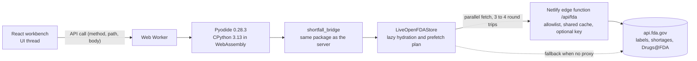

# Hosted demo on Netlify

The demo is the real system, not a mock-up. The browser downloads Pyodide (CPython compiled to
WebAssembly), mounts the `shortfall_bridge` package from this repository, and runs the same
engine, gates, retrieval, dose conversion, narrative, audit chain and API handlers that the server
runs. Data comes live from the public openFDA API, so every result is computed from current FDA
labels, Drug Shortages entries and Drugs@FDA therapeutic equivalence codes when you press the button.
No server, database or ingestion step is involved.

## Deploy in about two minutes

1. Push the repository to GitHub, GitLab or Bitbucket.
2. In Netlify choose **Add new site, Import an existing project**, then pick the repository.
3. Leave every field as detected. `netlify.toml` at the repository root sets the base directory
   (`frontend`), the build command (`npm run build:demo`), the publish directory (`dist`), the edge
   function and the security headers.
4. Optional: under **Site configuration, Environment variables** add `OPENFDA_API_KEY` with a free key
   from https://open.fda.gov/apis/authentication/. The edge function adds it server side, so it never
   reaches the browser, and the anonymous limit no longer applies.
5. Deploy. The site is served at `https://<your-site-name>.netlify.app`; rename it under
   **Site configuration, Change site name**, for example `shortfall-bridge-ai.netlify.app`.

Useful links once deployed:

| Link | Opens |
|---|---|
| `/#/workbench` | the workbench |
| `/#/workbench?drug=furosemide&route=intravenous&dose=40&freq=twice%20daily&crcl=42&meds=lisinopril&run=1` | a prefilled request that runs straight away |
| `/#/insights` | shortage landscape dashboard |
| `/#/calculators` | dose equivalence and renal function calculators |
| `/#/method` | method, data in use, and audit chain verification |

To deploy from GitHub Actions instead (with draft previews for pull requests), add the secrets
`NETLIFY_AUTH_TOKEN` and `NETLIFY_SITE_ID`; `.github/workflows/netlify-demo.yml` does the rest and
skips silently when they are absent.

## How the demo works



* `frontend/src/engine/transport.ts` routes every API call either to `fetch` (server mode) or to the
  worker (browser mode). Status codes, payloads and error shapes are identical, which
  `backend/tests/test_api_v2.py` proves by sending the same requests to FastAPI and to the
  framework free dispatcher (`backend/shortfall_bridge/api/dispatch.py`).
* `frontend/scripts/bundle-python.mjs` packs the Python source into `public/py/shortfall_bridge.json`
  at build time with a content hash in its version, so the deployed engine always matches the commit.
* The worker probes `/api/fda` first and falls back to `https://api.fda.gov` directly (openFDA allows
  cross origin requests), so the build also works on any static host.
* Pyodide ships pydantic, numpy and PyYAML. `pydantic-settings` and `prometheus_client` are optional in
  v2 (small built in fallbacks), so nothing is installed from PyPI at runtime.
* The engine runs in a worker, so the interface stays responsive and lazy fetches may use synchronous
  XMLHttpRequest, which browsers allow only in workers.

## Performance and limits

* First visit downloads about 17 MB before compression (12.3 MB Pyodide core, 5.1 MB for numpy,
  pydantic and PyYAML, 0.4 MB engine bundle); the CDN compresses it in transit and the browser
  caches it afterwards. In tests the engine starts in about 4 to 5 seconds on a fast connection.
* A typical recommendation needs 10 to 25 openFDA requests in 3 to 4 parallel batches. Later requests
  for the same drugs are answered from memory and from the edge cache.
* openFDA allows 240 requests a minute and about 1,000 a day per IP address without a key. Set
  `OPENFDA_API_KEY` on Netlify, or let visitors add their own key in the demo settings (gear icon).
* Live mode indexes the most recent labels per ingredient (5 in the browser) and uses hashing
  embeddings, so Tier 4 retrieval is weaker than in a full ingestion. Every response states the mode.

## Security headers

The Content Security Policy in `netlify.toml` allows scripts only from the site and
`cdn.jsdelivr.net` (Pyodide), WebAssembly compilation through `'wasm-unsafe-eval'` (no
`'unsafe-eval'`), and network access only to the site, openFDA and the CDN. The browser end to end
test runs under exactly this policy.

## Testing the demo locally

```bash
make demo                      # dev server with the in browser engine on live openFDA
cd frontend && E2E_PYODIDE_DIR=/path/to/pyodide-0.28.3 npm run test:e2e
```

The end to end test builds the demo, serves it with the production headers, emulates the edge proxy
in front of `backend/tests/openfda_emulator.py` (fixture data, no network) and drives Chromium through
21 checks: engine boot, ranking, evidence drawer, compare matrix, pharmacist review, note download,
share links, renal estimate, interaction blocking, insights, calculators, audit verification, dark
theme, a 390 pixel phone layout without horizontal scrolling, and zero console errors. CI runs it in
the `demo-e2e` job and uploads the screenshots.
